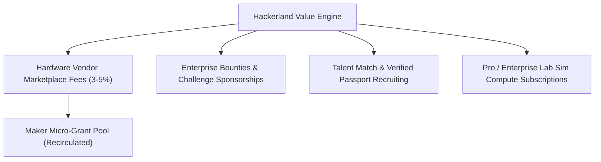

# Monetization & Economic Sustainability

Hackerland operates on an open-core, high-value ecosystem model designed to align incentives between indie builders, hardware suppliers, and enterprises:

1. **Fabrication & Component Marketplace Take Rate (3-5%):**
   - Routing Gerber files and BOM procurement to PCB plants, 3D printing services, and silicon distributors generates transactional affiliate/marketplace revenue.
   - 20% of net marketplace fees are automatically recirculated into the community Micro-Grant Pool.

2. **Corporate & Government Innovation Challenges:**
   - Enterprises and state innovation bodies sponsor Grand Challenges (e.g. \$10,000–\$100,000 prize pools).
   - Hackerland charges a standard curation, milestone verification, and challenge management fee.

3. **Verified Talent Pipeline & Passport Access:**
   - Companies recruit builders based on cryptographic proof-of-work (proven PCB designs, merged firmware, published research) rather than traditional resumes.
   - Subscription search fees for verified enterprise recruiters.

4. **Pro Maker & Enterprise Cloud Simulator Compute:**
   - Core in-browser tools remain permanently free for all creators.
   - Cloud-accelerated SPICE batch sweeps, FEA finite element thermal simulation, and private enterprise squad workspaces are available under tiered Pro subscriptions.
