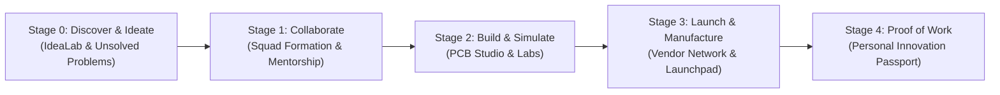

# Product Strategy: Hackerland Global Innovation Operating System

## 1. Executive Strategy

Hackerland transforms the traditional makerspace into a comprehensive, end-to-end Innovation Operating System. Instead of merely serving as a discussion board or a hobbyist directory, Hackerland accompanies any creator—from a 10-year-old student to an experienced deep-tech researcher—from initial curiosity to real-world deployment.

---

## 2. Target Archetypes

| Archetype | Key Entry Point | Core Need | Value Proposition |
|:---|:---|:---|:---|
| **Young Innovator (Ages 8–17)** | Young Innovators Track & IdeaLab | Safe exploration, low-barrier hardware/software tools | Supervised environment, gamified badges, age-safe mentorship |
| **College Student / Indie Maker** | Unsolved Problems & Challenges | Real portfolio proof-of-work, squad mates, bounties | Verifiable Innovation Passport, micro-grants, hackathons |
| **Hardware / Deep-Tech Engineer** | PCB Studio & Reverse Engineering | CAD tools, DRC checks, fabrication quotes | In-browser simulation, rapid supplier quoting across India |
| **Domain Researcher / Scientist** | Research Commons & Problem Library | Cross-disciplinary teams, open experimentation | Transparent peer review, research-to-product incubation |
| **Founder & Startup Operator** | Founder Stories & Funding Launchpad | Pre-seed grants, investor discovery, talent matching | Decision Archaeology insights, verified squad recruiting |

---

## 3. The 15 Product Pillars Matrix

1. **MakerSpace:** Central directory of physical labs, tools, open-source designs, and hardware build logs.
2. **IdeaLab:** Stage Zero 7-step idea workbook with structured problem validation and AI feedback.
3. **Collaboration Hub:** Real-time squad building, role matching, and cross-disciplinary matchmaking.
4. **Knowledge Universe:** Interactive, project-based engineering curricula from basic electronics to quantum computing.
5. **Founder Stories:** Decision Archaeology dissecting early failures, architectural pivots, and real unit economics.
6. **Research Commons:** Open research preprints, unsolved scientific inquiries, and open lab notebooks.
7. **Open Source Commons:** Verified open hardware and software repositories with contribution bounties.
8. **Mentorship Network:** Vetted industry mentors offering 1-on-1 office hours under strict DPDP child safety rules.
9. **Challenges & Competitions:** Industry and civic hackathons with transparent milestone escrow.
10. **Manufacturing & Resource Hub:** Integrated PCB fabrication, CNC milling, and 3D printing vendor network.
11. **Funding & Startup Launchpad:** Fellowship grants, angel network syndication, and pitch deck teardowns.
12. **Creative Studio:** Generative media, industrial CAD rendering, UI design systems, and brand assets.
13. **Young Innovators Track:** Sandboxed junior maker challenges with guardian controls and verified educator moderation.
14. **Events & Community:** Global chapters, demo days, hardware unboxing meetups, and local lab crawls.
15. **Innovation Archive:** Universal repository cataloging historical inventions, patents, and failed prototype autopsies.

---

## 4. Growth Flywheel

1. **Inbound Curiosity:** Curated Unsolved Problems and Decision Archaeology articles rank on search engines via IndexNow and structured schema.org data.
2. **Actionable Building:** Visitors don't just read—they launch the in-browser PCB Studio or fork an IdeaLab workbook directly.
3. **Verified Credentialing:** Every finished layout or merged pull request earns cryptographic credentials on their **Innovation Passport**.
4. **Ecosystem Value:** Hardware vendors, recruiters, and venture funds access the verified talent pool, driving revenue back into maker micro-grants.
