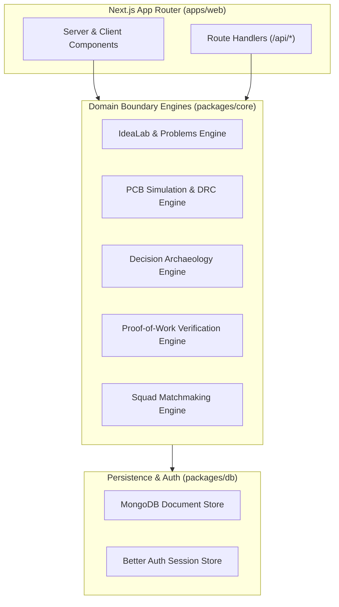

# Domain Boundaries & Architecture

Hackerland is architected as a **Modular Monolith** inside a Turborepo monorepo. This eliminates distributed systems overhead while enforcing strict domain isolation.

## Domain Partitioning

1. **Identity & Trust (`@hackerland/core/identity`):**
   - User profiles, handles, Better Auth adapter, session verification, and guardian verification for minors.
2. **Ideation & Discovery (`@hackerland/core/ideas`, `@hackerland/core/problems`):**
   - 7-stage workbook lifecycle, unsolved problem catalog, and claim validations.
3. **Hardware & Simulation (`@hackerland/core/circuits`, `@hackerland/core/physics`):**
   - Pure, deterministic calculation engines: schematic netlists, IPC-2221 trace clearance checks, physics ODE solvers.
4. **Knowledge & Stories (`@hackerland/core/stories`):**
   - Versioned markdown articles, decision forks, and pedagogical exercises.
5. **Collaboration & Opportunities (`@hackerland/core/projects`, `@hackerland/core/opportunities`):**
   - Squad applications, milestone escrow, bounty status machines.
6. **Innovation Passport (`@hackerland/core/passports`):**
   - Tamper-evident credentials, fabrication audit trails, and capability badges.
