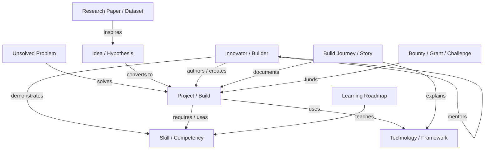

# Hackerland: Innovation Graph Architecture

## The Relational Knowledge & Innovation Substrate
Rather than a flat social network feed where posts vanish, Hackerland models human innovation as a typed, directed, evolving graph connecting 12 entity types:



### Relational Schema (MongoDB-backed initial implementation)
```typescript
interface InnovationGraphEdge {
  _id: ObjectId;
  fromType: 'person' | 'project' | 'problem' | 'idea' | 'skill' | 'technology' | 'story' | 'research';
  fromId: ObjectId;
  relation: 
    | 'created' 
    | 'solves' 
    | 'requires_skill' 
    | 'uses_tech' 
    | 'documented_by' 
    | 'mentors' 
    | 'funded_by' 
    | 'referenced_in';
  toType: 'person' | 'project' | 'problem' | 'idea' | 'skill' | 'technology' | 'story' | 'research';
  toId: ObjectId;
  metadata?: Record<string, any>;
  createdAt: Date;
}
```
This enables search queries like: *"Show me all projects solving water salinity that use low-power IoT, their bill of materials, and people who have mentored similar hardware."*
