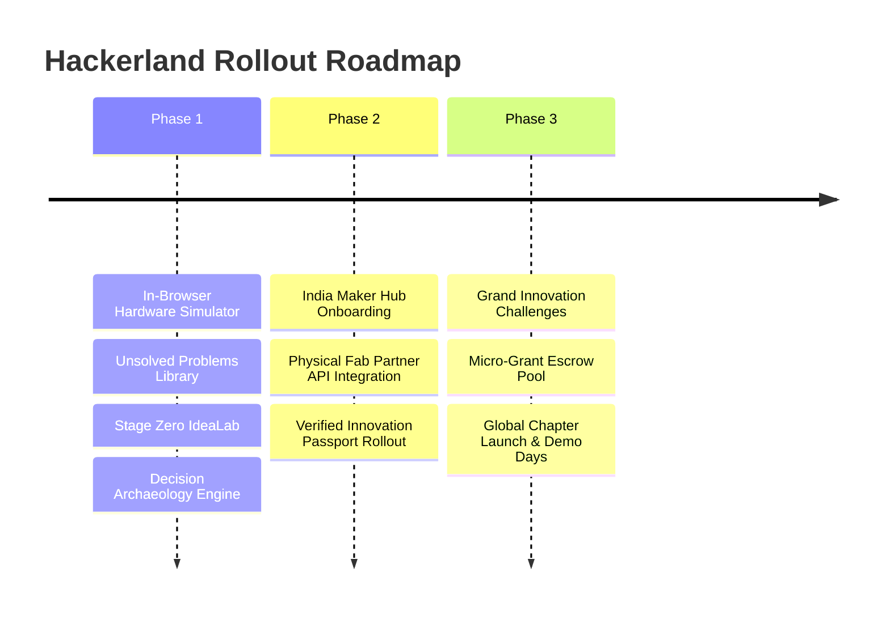

# MVP Roadmap & Execution Milestones

### Phase 1: Core Innovation Foundation (Current - Delivered)
- [x] In-browser A-to-Z PCB Design Studio with DRC, 3D photorealistic viewer, and Gerber RS-274X export.
- [x] Physics & Orbital space simulators (`/manufacturing/physics`, `/manufacturing/iss`).
- [x] Unsolved Problems Library (`/problems`) with structured impact targets and constraints.
- [x] Build Journey Archive (`/stories`) with interactive Decision Archaeology.
- [x] Stage Zero IdeaLab (`/ideas`) with 7-stage guided ideation workbook.
- [x] Personal Innovation Passport (`/passport`) with verified proof-of-work badges.
- [x] IndexNow, LLMs.txt, and Dynamic RSS syndication engine.

### Phase 2: Community & India-First Hardware Network (Q1 2027)
- [ ] Connect PCB Studio one-click ordering to domestic Indian fabrication houses (LionCircuits, PCB Power, Circuit99).
- [ ] Implement WebUSB / WebSerial for direct firmware flashing from browser to ESP32 / RP2040 microcontrollers.
- [ ] Pilot Young Innovators after-school lab programs with vetted STEM institutions across Bengaluru, Pune, and Hyderabad.

### Phase 3: Global Innovation Operating System (Q2 2027+)
- [ ] Multi-party real-time collaborative schematic CAD editing via WebRTC CRDTs.
- [ ] Automated micro-grant smart contract disbursements for completed problem bounties.
