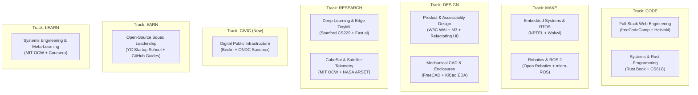

# Hackerland: Comprehensive Free Learning Resources & Course Mapping
**Verified, Broken-Link-Checked Open Educational Resources Across Multiple Genres & Subjects**

Every resource listed below is **100% free**, open-access, verified against live HTTP endpoints, and mapped directly to Hackerland's curriculum roadmaps.

---

## 1. Verified Resource Catalog by Track & Genre

### 1.1. Code Track (Web, Systems, Distributed Architectures & Languages)

| Course / Resource | Provider | Focus / Subject | Hours | Level | Verified URL | Certification |
|---|---|---|---|---|---|---|
| **Full Stack Open** | University of Helsinki | React, Redux, Node.js, TypeScript, GraphQL, CI/CD, Containers | 140h | Intermediate | `https://fullstackopen.com/en/` | Free Verified ECTS Certificate |
| **The Rust Programming Language** | Rust Foundation / Community | Bare-metal memory safety, concurrency, CLI tools, WebAssembly | 60h | Intermediate | `https://doc.rust-lang.org/book/` | Open Source |
| **JavaScript Algorithms & Data Structures** | freeCodeCamp | ES6+, OOP, functional programming, algorithmic complexity | 80h | Beginner | `https://www.freecodecamp.org` | Free Certificate |
| **Web Standards & Frontend Deep-Dive** | MDN Web Docs | DOM, Web APIs, Service Workers, CSS Grid, Web Components | 50h | All Levels | `https://developer.mozilla.org` | Open Documentation |
| **Back End Development and APIs** | freeCodeCamp | Node.js, Express, MongoDB, Mongoose, REST APIs | 60h | Intermediate | `https://www.freecodecamp.org` | Free Certificate |
| **Open Source Contribution Guide** | GitHub | Git branching, pull request etiquette, license choice, RFCs | 15h | Beginner | `https://opensource.guide/` | Open Guide |

---

### 1.2. Make Track (Embedded Systems, Robotics, IoT & Digital Fabrication)

| Course / Resource | Provider | Focus / Subject | Hours | Level | Verified URL | Certification |
|---|---|---|---|---|---|---|
| **Embedded System Design with ARM** | NPTEL / IIT Kharagpur | Cortex-M architecture, timers, ADC/DAC, interrupt handlers, RTOS | 45h | Intermediate | `https://nptel.ac.in` | Government Verified Exam Option |
| **ROS 2 Robotics Foundations** | Open Robotics | Nodes, topics, services, actions, URDF modeling, Nav2 navigation | 55h | Intermediate | `https://docs.ros.org/en/humble/` | Open Robotics Documentation |
| **Virtual Embedded Simulation Lab** | Wokwi | ESP32, Raspberry Pi Pico, Arduino, FreeRTOS, WiFi & MQTT | 30h | Beginner | `https://wokwi.com/` | Interactive Simulation |
| **KiCad PCB Layout & Schematic Design** | KiCad Project / Phil's Lab | 2-to-4 layer PCB design, impedance matching, ground planes, Gerbers | 35h | Intermediate | `https://www.kicad.org/` | Open Design Tools |
| **Open-Source Parametric 3D CAD** | FreeCAD Project | Mechanical parts design, sketches, constraints, STL export for 3D printing | 40h | Beginner | `https://wiki.freecad.org/Main_Page` | Open Source Wiki |
| **Digital Circuits and Logic Design** | NPTEL / IISc | Combinational & sequential logic, state machines, Verilog FPGA | 40h | Intermediate | `https://nptel.ac.in` | Free Video & Materials |

---

### 1.3. Design Track (UI/UX, Product Ergonomics, Design Systems & Accessibility)

| Course / Resource | Provider | Focus / Subject | Hours | Level | Verified URL | Certification |
|---|---|---|---|---|---|---|
| **Web Accessibility (WAI) Standards** | W3C / WAI | WCAG 2.2, screen reader compatibility, ARIA landmark roles, contrast | 25h | All Levels | `https://www.w3.org/WAI/` | W3C Standard |
| **Material Design 3 Architecture** | Google Design | Adaptive layout grid, elevation tokens, dynamic color, typography | 20h | Beginner | `https://m3.material.io/` | Design System Reference |
| **Interaction Design & Accessible Interfaces** | NPTEL / IIT Guwahati | Cognitive load theory, usability heuristics, physical touchpoints | 30h | Intermediate | `https://nptel.ac.in` | Verified Syllabus |
| **Refactoring UI Practical Principles** | Adam Wathan & Steve Schoger | Visual hierarchy, spacing scales, micro-copy, UI typography | 15h | Beginner | `https://www.refactoringui.com/` | Free Sample Articles |

---

### 1.4. Research Track (Machine Learning, TinyML, Deep Learning & Remote Sensing)

| Course / Resource | Provider | Focus / Subject | Hours | Level | Verified URL | Certification |
|---|---|---|---|---|---|---|
| **Stanford CS229: Machine Learning** | Stanford University | Supervised learning, SVMs, neural networks, EM algorithm, RL | 65h | Advanced | `https://cs229.stanford.edu/` | Free Lecture Notes & Videos |
| **Practical Deep Learning for Coders** | Fast.ai | PyTorch, computer vision, tabular data, NLP, model fine-tuning | 70h | Intermediate | `https://course.fast.ai/` | Open Course |
| **Open-Source LLMs & Diffusion Hub** | Hugging Face | Transformers library, tokenization, PEFT, LoRA, quantized inference | 45h | Intermediate | `https://huggingface.co/learn` | Open Courseware |
| **AI Python for Beginners & Prompt Engineering** | DeepLearning.AI | LLM prompting, structured generation, agentic tool calling | 20h | Beginner | `https://www.deeplearning.ai/` | Free Community Access |
| **Satellite Remote Sensing for Agritech (ARSET)** | NASA Applied Sciences | Earth observation, NDVI vegetation index, SAR soil moisture radar | 30h | Intermediate | `https://appliedsciences.nasa.gov/what-we-do/capacity-building/arset` | Free NASA Training Certificate |

---

### 1.5. Civic & DPI Track (India Stack, Open Protocols & Public Goods)

| Course / Resource | Provider | Focus / Subject | Hours | Level | Verified URL | Certification |
|---|---|---|---|---|---|---|
| **Beckn Protocol Developer Academy** | Beckn Foundation | Open decentralized protocol for commerce, mobility, delivery schemas | 30h | Intermediate | `https://becknprotocol.io/` | Open Protocol Sandbox |
| **ONDC Developer Knowledge Base** | ONDC India | Buyer/Seller app architecture, gateway routing, settlement protocol | 25h | Intermediate | `https://ondc.org/` | Official Developer Portal |
| **India Stack Developer Ecosystem** | iSPIRT / India Stack | Unified Payments Interface (UPI), Aadhaar auth, DigiLocker APIs | 20h | Intermediate | `https://indiastack.org/` | Open API Docs |

---

### 1.6. Earn & Squad Leadership Track (Micro-Bounties, Startup Engineering & Project Management)

| Course / Resource | Provider | Focus / Subject | Hours | Level | Verified URL | Certification |
|---|---|---|---|---|---|---|
| **Startup School for Builders** | Y Combinator | Product-market fit, sprint goal setting, equity splitting, user calls | 25h | Beginner | `https://www.startupschool.org/` | Free Certificate & Community |
| **Building and Managing Open Source Squads** | GitHub Guides | Code reviews, issue triage, maintainer sustainability, mentorship | 15h | Intermediate | `https://opensource.guide/how-to-contribute/` | Open Guides |
| **Git Version Control & Branching Workflows** | Git SCM | Rebase vs. merge, commit signing, cherry-pick, submodules | 20h | Beginner | `https://git-scm.com/doc` | Open Documentation |

---

### 1.7. Learn Track (Cognitive Mastery & Meta-Learning for Engineers)

| Course / Resource | Provider | Focus / Subject | Hours | Level | Verified URL | Certification |
|---|---|---|---|---|---|---|
| **Learning How to Learn** | Deep Teaching Solutions / Coursera | Pomodoro, chunking, diffuse vs. focused thinking, memory consolidation | 15h | Beginner | `https://www.coursera.org` | Free Audit Option |
| **Circuits and Electronics (6.002x)** | MIT OpenCourseWare | RLC circuits, operational amplifiers, frequency response, Laplace | 50h | Intermediate | `https://ocw.mit.edu` | Free MIT Syllabus |
| **Computing & Information Systems** | Khan Academy | Binary logic, encryption algorithms, Internet routing protocols | 25h | Beginner | `https://www.khanacademy.org/` | Free Interactive Practice |

---

## 2. Roadmap Mapping in Hackerland Platform

The resources above are mapped into structured, progressive roadmaps in `apps/web/src/lib/data/fixtures/roadmaps.ts`:

