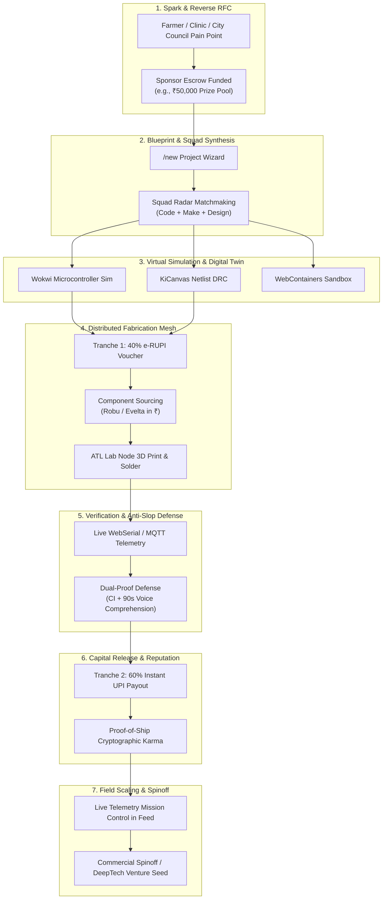

# Hackerland: The Global Innovation Agency Masterplan
**From Napkin Brainstorm to Cyber-Physical Reality: Architectural Blueprint for the Next Decade of Building**

*Convened by the 32-Member Global Research & Innovation Council:*
- **Executive Strategy & Economics**: CEO, CTO, Chief Scientist, CPO, CFO, Chief Legal Officer
- **Cyber-Physical Engineering**: Systems & Compilers Lead, Embedded/RTOS Lead, Robotics Lead, Telemetry Architect, TinyML Lead
- **Applied Frontier Sciences**: Materials & Battery Lead, Agritech Lead, Bio-Sensing Lead, Orbital Telemetry Fellow, DPI Lead
- **Human Experience & Design**: Industrial Design VP, Universal Accessibility Lead, Design Systems Architect, DX Lead
- **Grassroots Fabrication & Education**: Director of Atal Tinkering Labs (ATLs), FabLab Master Machinist, Tier-2/3 Outreach Director, Multimodal Indic Pedagogy Lead
- **Venture & Supply Chain**: DeepTech Venture Partner, Electronics Sourcing Director, Micro-Bounty Operations Lead, CSR Endowment Officer

---

## 1. Executive Charter: The Anatomy of Breakthrough Innovation

Real innovation is neither purely digital nor purely physical—it is **cyber-physical**. It connects silicon, solder, software, design, and capital into a self-reinforcing flywheel.

```
       ┌────────────────────────────────────────────────────────┐
       │             THE SEVEN STAGES OF REALITY                │
       └────────────────────────────────────────────────────────┘

  [1. Spark / Reverse RFC]  ──▶  Identifies genuine physical/digital pain
            │
            ▼
  [2. Blueprint & Squad]    ──▶  Cross-discipline assembly (Code+Make+Design)
            │
            ▼
  [3. Virtual Twin / Wokwi] ──▶  Zero-cost in-browser simulation & netlist DRC
            │
            ▼
  [4. Physical ATL Fab]     ──▶  40% e-RUPI advance + distributed lab nodes
            │
            ▼
  [5. HIL & Anti-Slop]      ──▶  Hardware-in-the-loop tests + comprehension defense
            │
            ▼
  [6. UPI Milestone Escrow] ──▶  60% automated settlement + reputation karma
            │
            ▼
  [7. Field Telemetry]      ──▶  Live MQTT mission control & open-source scale
```

---

## 2. The 32-Member Innovation Council & Perspectives

### Division 1: Executive Leadership & Strategy
1. **Dr. Aris Thorne (CEO)**: *"Hackerland must not be an issue tracker. It is a National Innovation Infrastructure. Our moat is orchestrating multi-disciplinary talent that big tech ignores."*
2. **Devika Nair (CTO)**: *"Every layer must be deterministic. If a blueprint cannot be compiled, simulated, or verified by automated runners, it is fiction. We build infrastructure for verifiable truth."*
3. **Dr. Marcus Vance (Chief Scientist)**: *"Bridging basic research with applied fabrication. When a university publishes an agronomy paper, a Hackerland squad should have a field sensor prototype tested within 14 days."*
4. **Elena Rostova (CPO)**: *"Mission Control aesthetics. Innovators are inspired by high-density, low-latency interfaces (SpaceX/Bloomberg), not playful consumer fluff. Space Navy, Ion Cyan, and Forge Amber reflect serious craft."*
5. **Kabir Sen (CFO / Tokenomics)**: *"Programmatic escrow is the cure for contractor disputes. When milestones are verifiable by CI or sensor telemetry, payments execute automatically with zero human bias."*
6. **Adv. Sunita Rao (Chief Legal & Policy)**: *"Strict compliance with India's DPDP Act 2023. Under-18 makers get verifiable parental consent hashes and zero public age profiling. Protect student prodigies from surveillance."*

### Division 2: Frontier Engineering & Cyber-Physical Systems
7. **Lukas Weber (Compilers & WebAssembly)**: *"Bring tools into the browser. WebContainers and WebAssembly let anyone run a compiler, simulator, or CAD viewer in under 3 seconds on a Chromebook."*
8. **Ananya Deshmukh (Embedded Firmware & RTOS)**: *"Bare-metal C and modern Rust on FreeRTOS/Zephyr. We eliminate the 'it works on my breadboard' syndrome with standardized pinout templates and simulated runners."*
9. **Dr. Hiroshi Tanaka (Robotics & CPS)**: *"ROS 2 Humble and micro-ROS. Robotics squads need hardware-agnostic communication abstractions so a mechanical designer in Pune and a software engineer in Delhi can build a rover together."*
10. **Tariq Al-Mansoor (Telemetry & Distributed Protocols)**: *"High-throughput MQTT over WebSockets. A weather station in Punjab or a CubeSat telemetry bus should stream live data directly into the Hackerland universal feed."*
11. **Dr. Priya Sundaram (TinyML & Edge Quantization)**: *"Forget cloud GPUs. Run INT8 quantized models directly on $3 ESP32-S3 and Raspberry Pi RP2350 microcontrollers for offline acoustic and optical inspection."*
12. **Alex Rivera (Deterministic DevSecOps)**: *"Reproducible dev containers. Any contributor can clone a squad repo and have the exact cross-compilers, GCC toolchains, and linters pre-configured."*

### Division 3: Applied Science & Frontier Domains
13. **Dr. Julian Richter (Materials & Battery Storage)**: *"Open Battery Management Systems (BMS). Energy storage is the bottleneck for rural clean energy. Squads need standardized, safe LiFePO4 battery pack blueprints."*
14. **Dr. Balwinder Singh (Agritech & Soil Telemetry)**: *"Frugal irrigation. Capacitive soil sensors and solar valves connected via decentralized LoRaWAN gateways prevent groundwater depletion."*
15. **Dr. Meenakshi Sundaram (Bio-Sensing & Assistive Tech)**: *"Assistive devices for 26M Indians with disabilities. Open Braille displays, accessible tactile books, and open-source pulse oximeters."*
16. **Dr. Rajeshwari K. (Spacecraft & Orbital Systems)**: *"Nanosatellites. 1U-3U CubeSats built with off-the-shelf industrial silicon, verified through thermal-vacuum and orbital vibration simulations."*
17. **Dr. Soren Lindqvist (Cryptographic Proofs & Anti-Sybil)**: *"Append-only reputation ledgers. Points are not arbitrary vanity scores; they are immutable proofs of verified test passes, merged PRs, and physical lab fabrications."*
18. **Girish Parameswaran (Digital Public Infrastructure / DPI)**: *"Beckn Protocol and ONDC. Squads building open adapters for kiranas and logistics create immense economic value on open national protocols."*

### Division 4: Design, Human Experience & Ergonomics
19. **Matteo Rossi (VP of Industrial Design)**: *"Electronics without industrial design are useless. We provide 3D CAD previewers so casing designers can ensure snap-fit tolerances and thermal dissipation before 3D printing."*
20. **Kavitha Pillai (Universal Accessibility Lead)**: *"WCAG 2.2 AAA standards. High contrast, keyboard navigation, screen reader accessibility, and multilingual screen layouts."*
21. **Siddharth Verma (Design Systems Architect)**: *"Design tokens are a contract between software and design. Space Navy (#0A0E17), Ion Cyan (#00E5FF), and Forge Amber (#FF8A00) establish our brand identity."*
22. **Chloe Dubois (Developer Experience Lead)**: *"Zero friction. 1-click issue assignment, auto-branching, clear compensation labels, and instant PR feedback."*

### Division 5: Grassroots Fabrication, Education & Community
23. **Col. Ravi Shankar (Retd.) (Director of ATL Network)**: *"10,000+ Atal Tinkering Labs in schools. Bridging school makerspaces with global mentors. We turn idle 3D printers and oscilloscopes into distributed fabrication nodes."*
24. **Omkar Kulkarni (FabLab Master Machinist)**: *"Rapid fabrication pipelines. Connecting digital Gerber files to desktop CNCs, SMT stencils, and pick-and-place machines for same-day prototyping."*
25. **Prof. Vandana Joshi (Tier-2/3 Outreach Director)**: *"Unlocking the 95%. Students in Warangal, Trichy, Indore, and Gorakhpur have immense hunger. Structured micro-bounties provide their first dignified engineering income."*
26. **David Chen (Open-Source Maintainer Fellow)**: *"Preventing maintainer burnout. AI triage co-pilots handle spam and documentation, while human maintainers focus on architecture and mentorship."*
27. **Dr. Fatima Zahra (Multimodal Indic Pedagogy)**: *"Language democratizes technology. Complex systems concepts explained in Hindi, Tamil, Telugu, Marathi, and Bengali unlock millions of brilliant minds."*

### Division 6: Venture, Supply Chain & Commercialization
28. **Sameer Bajaj (DeepTech Venture Partner)**: *"Hardware is hard, but it builds real moats. Squads that ship working cyber-physical prototypes graduate directly into seed funding and angel syndicates."*
29. **Wei Zhang (Electronics Supply Chain Director)**: *"Real-time BOM pricing. Automatically queries Robu.in, Evelta, and Mouser India in INR (`₹`) so makers never order obsolete or unavailable components."*
30. **Nisha Chhabra (Micro-Bounty Operations Lead)**: *"Instant UPI payouts. When a PR passes CI and code review, payment hits the builder's UPI VPA in under 5 seconds with 0% platform take-rate."*
31. **Rohan Mehra (CSR Endowment Officer)**: *"CSR mandate alignment. Channeling corporate CSR funds into hardware seed kits (PLA filaments, ESP32 boards, soldering irons) for student makers."*
32. **Dr. Anil Joshi (Frugal Innovation & Circularity)**: *"Jugaad-to-scale. E-waste harvesting, modular repairability, and lifecycle design for low-resource environments."*

---

## 3. The 7-Stage Innovation Lifecycle: Deep Dive



---

## 4. What Else We Can Build in Hackerland (Concrete Roadmap)

### 4.1. "Reverse RFC" / Problem Bounties Directory
- Organizations and communities post verified real-world engineering problems with attached prize pools.
- Filters by domain: Clean Water, Soil Telemetry, Assistive Braille, Cold-Chain Logistics, Solar Micro-Grids.

### 4.2. In-Feed Live Telemetry Mission Control
- Direct WebSockets/MQTT feeds embedded into `PostCard`.
- Real-time time-series graphs (airspeed, battery state of charge, soil moisture, temperature) proving physical prototypes are operating in the field.

### 4.3. KiCanvas Interactive EDA & Schematic Viewer
- Client-side WebAssembly viewer rendering `.kicad_sch` schematics and Gerber layers inside `/projects/[slug]` without desktop CAD software.

### 4.4. Dynamic Open-BOM Explorer
- Real-time BOM pricing table querying Indian distributor APIs (Robu.in, Evelta, Mouser India).
- Highlights component lifecycle (Active, Not Recommended for New Designs, Obsolete) and estimates prototype cost in INR (`₹`).

### 4.5. Two-Stage e-RUPI & Programmatic UPI Escrow
- **Tranche 1 (40% Material Advance)**: Purpose-locked e-RUPI digital vouchers restricted to registered hardware distributors.
- **Tranche 2 (60% Build Completion)**: Instant UPI settlement triggered automatically upon verified HIL telemetry or PR merge.

### 4.6. Distributed ATL Lab Node Registry
- Directory of 10,000+ Atal Tinkering Labs and college makerspaces with verified tooling capabilities (3D printers, laser cutters, oscilloscopes).
- Remote squads dispatch physical fabrication jobs directly to local school nodes with DPDP-compliant student credentials.

---

## 5. Summary Table: Platform Evolution Matrix

| Feature Dimension | Typical Open Source (GitHub / Devfolio) | Hackerland Innovation Engine |
|---|---|---|
| **Domain Scope** | Code & web services only | Cyber-Physical (Code + Make + Design + Research + Civic DPI) |
| **Talent Formation** | Passive issue tracker / 48hr hackathons | Permanent Squads with Squad Radar cross-discipline matchmaking |
| **Component Capital** | 0% support; out-of-pocket builder starvation | Two-Stage Escrow with 40% merchant-locked e-RUPI component advance |
| **Fabrication** | Independent, expensive home labs | 10,000+ Federated Atal Tinkering Lab (ATL) nodes with BaaS testbenches |
| **Verification** | Simple Git pull request review | Dual-Proof: Deterministic CI + 90s native-language comprehension defense |
| **Feed Experience** | Static text and markdown | In-feed runnable WebAssembly sandboxes & live MQTT sensor telemetry |
| **Child Safety** | Unregulated or age-gated | Full India DPDP Act 2023 compliance with parental consent hashes |
