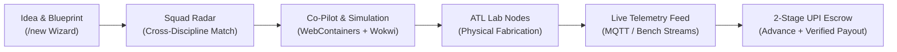
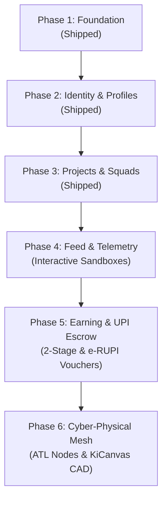

# Hackerland: Strategic Innovation & Ecosystem Expansion Blueprint
**De-siloing Software, Hardware, and Capital for the Next Billion Builders**

*Synthesized from the Multi-Agent Innovator Council Debate:*
- **Dr. Vikram** — DeepTech, Physical Fabrication & Hardware Architect (`@innovator-deeptech`)
- **Aisha** — AI Systems, Local Open Weights & Agentic Infrastructure (`@innovator-ai-oss`)
- **Maya** — Talent Economy, Tier-2/3 Outreach & Apprenticeships (`@agent-earn-learn`)
- **Rohit** — Community Architecture, Telemetry Feeds & Matchmaking (`@agent-feed-profile`)
- **Karan** — Trust, UPI/e-RUPI Escrow & DPDP Child Safety (`@agent-auth-wizard`)

---

## 1. Executive Summary & The Core Thesis

Modern open-source and developer ecosystems are trapped in three critical failure modes:
1. **The Software Echo Chamber**: 90% of tools cater exclusively to cloud microservices and web apps, ignoring the urgent physical engineering challenges of the Global South (smart irrigation, rural micro-grids, point-of-care medical devices, localized EV mobility).
2. **Transient Hackathon Energy vs. Sustained Building**: Weekend hackathons create demo hype that dissolves on Monday morning. GitHub is passive file hosting without built-in talent formation or capital rails.
3. **The Capital & Trust Chasm**: Aspiring makers in Tier-2/3/4 towns (Warangal, Indore, Trichy, Gorakhpur) face out-of-pocket starvation for basic hardware components (dev boards, sensors, PCB fabrication), while maintainers drown in hallucinated, AI-generated "code slop" PRs.

**Hackerland's Moat:** Hackerland is the **National Cyber-Physical Innovation Mesh**—a unified mission control where developers, physical makers, industrial designers, and researchers form permanent squads around high-conviction blueprints, test against physical and simulated testbenches, and earn programmatic milestone bounties via instant UPI/e-RUPI escrow.



---

## 2. Expanded Multi-Genre Track Taxonomy

Beyond the initial 6 foundational tracks (`code`, `make`, `design`, `research`, `earn`, `learn`), the Council recommends expanding into high-gravity, domain-specific tracks:

| Track / Sub-Track | Focus & Scope | Core Open-Source Technologies | Target Impact |
|---|---|---|---|
| **`civic` (DPI / India Stack)** | Open Digital Public Infrastructure: commerce, health, mobility, education | Beckn Protocol, ONDC APIs, Ayushman Bharat (ABDM), DigiLocker, UPI sandbox | Democratizing commerce for 60M micro-enterprises and public health clinics |
| **`climate` (CleanTech & Agritech)** | Planetary engineering: low-power soil telemetry, solar micro-inverters, farm cold-storage | LoRaWAN, ESP32, MQTT telemetry, Open Weather APIs, LiFePO4 Battery Management (BMS) | Frugal engineering for smallholder farmers and decentralized clean energy grids |
| **`robotics` (Cyber-Physical Systems)** | Autonomous mobile robots, manipulators, micro-drones, sensor fusion | ROS 2, micro-ROS, RTOS (FreeRTOS/Zephyr), PX4 Autopilot, OpenCV | Industrial automation, assistive mobility, disaster relief UAVs |
| **`biotech` (Assistive & Rural MedTech)** | Accessible medical devices, tactile interfaces, biosensors | Open-source ECG/PPG, 3D bionic prosthetics, Braille displays, ASTM medical compliance | Low-cost assistive hardware for India's 26M persons with disabilities |
| **`ai-edge` (TinyML & Open Weights)** | In-browser zero-cloud-cost inference, ultra-low-power edge microcontrollers | WebGPU, Transformers.js, TFLite Micro, microTVM, Qwen-2.5-Coder, Llama-3.2 (1B/3B) | AI intelligence running offline on $3 chips without cloud server dependencies |

---

## 3. Breakthrough Platform Capabilities (The 10x Moat)

### 3.1. Interactive In-Feed Sandboxes & Virtual Hardware Twins
Static screenshots and code blocks do not prove reality. Hackerland transforms the Universal Feed (`/feed`) into an active testbed:
- **WebAssembly Code Sandboxes**: 1-click "Inspect & Run" on any code snippet or model benchmark directly inside `PostCard`.
- **Wokwi / QEMU Virtual Twins**: Embedded firmware simulation. Readers can interact with virtual buttons, inspect virtual OLED displays, and trigger I2C sensor simulations in the browser.
- **Live MQTT / Telemetry Streams**: Projects like AeroGlide or KisanSense stream live sensor curves (wind tunnel airspeed, battery discharge rates, soil moisture graphs) directly onto their feed cards.

### 3.2. KiCanvas & 3D CAD Web Viewers
- Full browser-based WebAssembly rendering of KiCad `.kicad_sch` schematics and PCB Gerbers via **KiCanvas**.
- Interactive Three.js/WebGL viewers for `.step` and `.stl` enclosures, allowing mechanical designers and electrical engineers to review CAD fits without heavy desktop workstation software.

### 3.3. Dynamic Open-BOM (Bill of Materials) Engine
- Automatically parses KiCad/EasyEDA component lists.
- Queries real-time Indian and global component distributor inventory (Robu.in, Evelta, Mouser, LCSC) with live prices in INR (`₹`).
- Flags obsolete or end-of-life silicon and suggests pin-compatible domestic alternatives.

### 3.4. Squad Radar: Cross-Discipline Matchmaking Engine
- Resolves the classic failure mode where brilliant embedded developers lack industrial designers or software hackers lack hardware expertise.
- Proactively scans builder handles by track, verified experience badges, and reputation scores to recommend squad members with guaranteed compensation splits (stipend, equity, bounty, or revenue share).

---

## 4. Federated Atal Tinkering Labs (ATL) & Distributed Fabrication Mesh

India has established **10,000+ Atal Tinkering Labs (ATLs)** in schools and hundreds of FabLabs/AIC-STPI incubation centres in engineering colleges. Most have 3D printers, digital storage oscilloscopes, and soldering stations that sit idle outside school hours.

### 4.1. "Bench-as-a-Service" (BaaS) Architecture
- ATLs and college makerspaces register as verified **Lab Nodes** (e.g., `Node: ATL-Vellore-042`).
- Each node connects an automated test rig (Raspberry Pi / ESP32 runner) over WebSerial/WebUSB with an authenticated video feed.
- Remote software squads can compile firmware, flash it over the internet to physical hardware in the school lab, and observe real-world sensor telemetry and LED states.

### 4.2. Physical Fabrication Bounties
- A remote software squad designing an assistive Braille device dispatches a 3D-printing and soldering job to a nearby ATL node.
- Local students fabricate, assemble, and test the board, earning:
  1. Verifiable **Maker Karma** in their reputation ledger.
  2. Micro-bounties funded by CSR partnerships (Tata Trusts, Texas Instruments, STMicro).
  3. Portable, DPDP-compliant experience badges ("Hardware Fabricator", "Lab Node Lead").

### 4.3. Consumables CSR Endowment Pool
- A 5% platform CSR fund specifically replenishes physical consumables (PLA/PETG filaments, solder flux, PCB blanks, copper clad, passive components) so public schools never run out of supplies.

---

## 5. Economic & Trust Architecture

### 5.1. Two-Stage Hardware Escrow & Merchant-Locked e-RUPI Vouchers
Hardware projects cannot survive single-stage "pay upon PR merge" contracts because component acquisition requires immediate capital.

```
[Sponsor Locks ₹25,000 in Escrow]
             │
             ├──────────────────────────────────────────────────────┐
             ▼                                                      ▼
[Tranche 1: 40% (₹10,000)]                             [Tranche 2: 60% (₹15,000)]
• Issued as merchant-locked e-RUPI                     • Programmatic UPI disbursement
  voucher or direct checkout token                     • Triggered only when:
• Restricted to Robu.in / Evelta / Mouser                1. Wokwi automated tests pass
• Zero out-of-pocket cost for maker                     2. ATL Lab Node signs HIL telemetry
• Zero cash diversion risk for sponsor                   3. Squad lead approves merge
```

### 5.2. The Dual-Proof Anti-Slop Defense (Eradicating AI Hallucinations)
To prevent bad actors from flooding bounties with auto-generated LLM code:
1. **Proof 1 (Deterministic CI)**: Unit tests, static analysis, property-based tests, and license scans must pass with 100% success.
2. **Proof 2 (Interactive Comprehension Defense)**: Before payout, the contributor must pass a 90-second voice or text comprehension check generated dynamically from their diff (e.g., *"Why did you use a circular ring buffer instead of a mutex in this DMA interrupt?"*). Answers can be provided in **Hindi, Tamil, Telugu, Marathi, or English**.

### 5.3. Proof-of-Postmortem: Resilience Karma
Physical engineering entails silicon burn-in, component delays, and thermal failures. If a prototype fails:
- The squad publishes an open-source **"Failure RCA & Design Postmortem"** with oscilloscope traces and root cause analysis.
- The platform awards **"Resilience Karma"** and releases partial compensation, transforming failure into public educational value.

### 5.4. India DPDP Act 2023 Child Safety Compliance
- **Zero Age Profiling**: No public ages ("Age 15") displayed on profiles. Only opt-in experience badges ("Student", "Junior Maker", "Lead").
- **Verifiable Parental Consent Hashes**: Cryptographic parent/guardian authorization tokens for under-18 contributors.
- **Mentorship Pairing Oversight**: Auditable, recorded mentor-student pairing for all school-age lab participants.

---

## 6. Implementation Phasing Matrix



| Phase | Milestone | Core Deliverables | Timeline |
|---|---|---|---|
| **Phase 4** | Universal Feed & Telemetry | Live MQTT/WebSocket telemetry cards, interactive WebAssembly sandboxes, discussion threads, upvote engine | Sprint 4 |
| **Phase 5** | Earning & Escrow Engine | Programmatic UPI milestone escrow, e-RUPI voucher integration, bounty claim lifecycle, payout verification | Sprint 5 |
| **Phase 6** | Cyber-Physical ATL Mesh | KiCanvas Wasm PCB viewer, 3D CAD viewer, ATL Lab Node directory, Hardware-in-the-Loop testbench integration | Sprint 6 |
| **Phase 7** | Reputation & Squad Radar | Append-only reputation ledger, anti-sybil quadratic grant rounds, automated cross-discipline matchmaking | Sprint 7 |
| **Phase 8** | Open Hardware Marketplace | Verified component BOM checkout (Robu/Evelta APIs), surplus lab exchange, parts pooling | Sprint 8 |
